  <a href="https://yrei.dev/">
    <picture>
      <source media="(prefers-reduced-motion: reduce) and (max-width: 600px)" srcset="https://raw.githubusercontent.com/yreidev/yreidev/main/assets/yrei-compact.webp">
      <source media="(prefers-reduced-motion: reduce)" srcset="https://raw.githubusercontent.com/yreidev/yreidev/main/assets/yrei.webp">
      <source media="(max-width: 600px)" srcset="https://raw.githubusercontent.com/yreidev/yreidev/main/assets/yrei-spirit-mobile.svg">
      
    </picture>
  </a>

**Yrei**，读作 *Y-ray*，取自「幽霊」。这里做可以放在自己服务器上的软件，也做从终端和手机连回去的工具。 Self-hosted software, within reach from a terminal or a phone.

[进入个人站 / yrei.dev ↗](https://yrei.dev/) · [浏览全部仓库 / Repositories ↗](https://github.com/yreidev?tab=repositories)

## 开源作品 / Selected work

  <a href="https://github.com/yreidev/workbuddy2api-panel">
    <picture>
      <source media="(prefers-reduced-motion: reduce) and (max-width: 600px)" srcset="https://raw.githubusercontent.com/yreidev/yreidev/main/assets/gateway-mobile.webp">
      <source media="(prefers-reduced-motion: reduce)" srcset="https://raw.githubusercontent.com/yreidev/yreidev/main/assets/gateway.webp">
      <source media="(max-width: 600px)" srcset="https://raw.githubusercontent.com/yreidev/yreidev/main/assets/gateway-mobile.svg">
      
    </picture>
  </a>

这个独立维护的增强版，让 Claude Code 和 Codex 连上腾讯 WorkBuddy。账号和模型路由都在自己的服务器上管理。 A self-hosted gateway connecting Claude Code and Codex to Tencent WorkBuddy.

[项目源码 / Source](https://github.com/yreidev/workbuddy2api-panel) · [下载发行版 / Releases](https://github.com/yreidev/workbuddy2api-panel/releases/latest) · [部署指南 / Deployment](https://github.com/yreidev/workbuddy2api-panel/blob/main/docs/deployment.md)

<table>
  <tr>
    <td width="76" align="center"></td>
    <td><strong><a href="https://github.com/yreidev/sub2api-sgm">Sub2API SGM</a></strong> 选模型、领密钥、查请求明细。 Model discovery, API keys and request history for Sub2API.</td>
  </tr>
  <tr>
    <td width="76" align="center"></td>
    <td><strong><a href="https://github.com/yreidev/Tillbox">Tillbox</a></strong> 自托管收银台，兼容易支付 V1 / V2，可逐笔核对订单和到账流水。 A self-hosted checkout that matches payments to orders.</td>
  </tr>
  <tr>
    <td width="76" align="center"></td>
    <td><strong><a href="https://github.com/yreidev/AcePocket">AcePocket</a></strong> 从手机直连自己的 AcePanel，查看服务器负载、容器和日志。 An unofficial Flutter client for managing AcePanel servers.</td>
  </tr>
</table>

**上游贡献 / Upstream** · 为 CC Switch 补上 Qwen4 Max 的模型定价数据。[已合并的 PR #9612 ↗](https://github.com/farion1231/cc-switch/pull/9612)

## 贡献轨迹 / Contribution trail

<picture>
  <source media="(prefers-reduced-motion: reduce) and (prefers-color-scheme: dark)" srcset="https://raw.githubusercontent.com/yreidev/yreidev/output/contributions-dark.svg">
  <source media="(prefers-reduced-motion: reduce)" srcset="https://raw.githubusercontent.com/yreidev/yreidev/output/contributions.svg">
  <source media="(prefers-color-scheme: dark)" srcset="https://raw.githubusercontent.com/yreidev/yreidev/output/github-contribution-grid-snake-dark.svg">
  
</picture>
